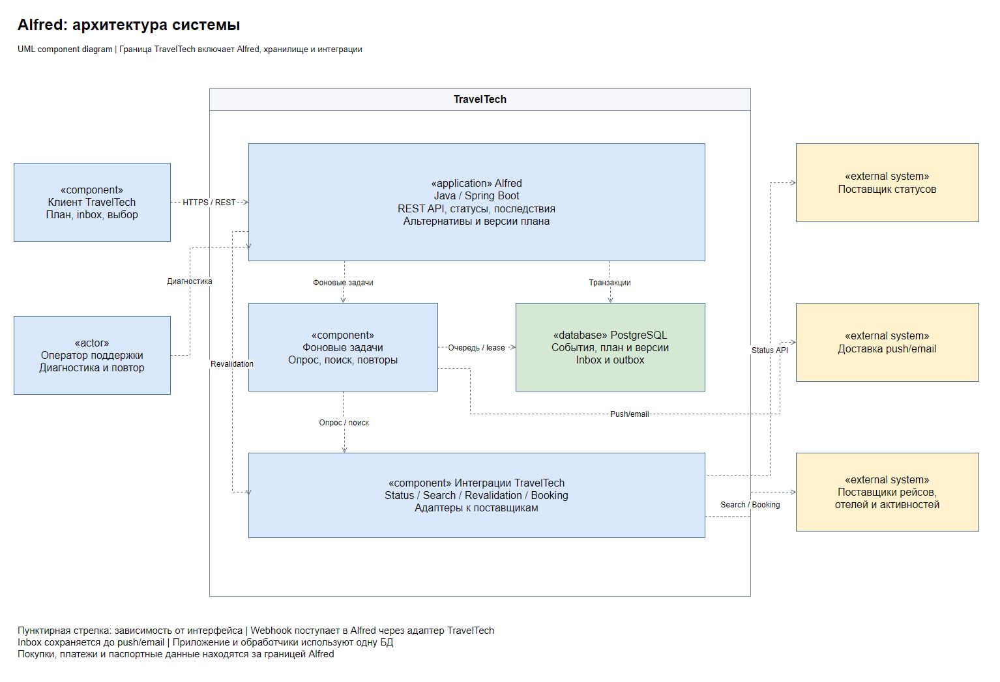

# Alfred: изменение плана путешествия

Решение кейса «Альфред, друг Бэтмена» по системному анализу

Alfred отслеживает рейсы участников поездки, сообщает о задержках и отменах, предлагает допустимые перелёты или активности и сохраняет согласованные изменения общего плана

Результат работы: спецификация системы, схемы UML/BPMN и контракт OpenAPI. Документы описывают проектное решение; сервер и реальные интеграции не реализованы

## Решение

1. Получить событие статуса или запросить состояние рейса
2. Проверить рейс, источник, повтор и актуальность данных
3. Оценить влияние на пересадки, отель, трансфер и активности
4. Сохранить уведомления для участников, затем отправить push/email
5. При нарушении плана подобрать варианты с учётом ограничений всей группы
6. После выбора участником повторно проверить вариант и сохранить новую версию плана

## Документы

| Порядок | Документ | Содержание |
|---|---|---|
| 1 | [Требования](docs/requirements.md) | Границы, роли, поведение и ограничения |
| 2 | [Архитектура](docs/architecture.md) | Компоненты, обработка событий и надёжность |
| 3 | [Модель данных](docs/data-model.md) | Сущности, связи и ограничения PostgreSQL |
| 4 | [Интеграции](docs/integrations.md) | Внешние зависимости и правила API |
| 5 | [Пример поездки](docs/example.md) | Задержка, альтернативы и изменение плана |
| 6 | [Приёмочные сценарии](docs/acceptance.md) | Проверка требований и исключений |

[OpenAPI](api/openapi.yaml) можно открыть в Swagger Editor локально или в его веб-версии

Редактируемые схемы и изображения: [архитектура](docs/diagrams/01-architecture.drawio), [BPMN обработки статуса](docs/diagrams/02-status-process.drawio), [UML подтверждения](docs/diagrams/03-selection-sequence.drawio), [UML данных](docs/diagrams/04-data-model.drawio)

## Граница системы

Alfred является подсистемой TravelTech. Поиск, бронирование и проверку права на маршрут предоставляет окружающий TravelTech через внутренние интерфейсы. Это допущение проектирования, а не подключённые готовые API

Alfred сохраняет выбранный план, но не выпускает билеты, не меняет брони у поставщиков, не проводит платежи и не получает паспортные данные. Для новых бронирований и изменений создаются отдельные действия пользователя

## Технологии

| Технология | Назначение |
|---|---|
| Java 21, Spring Boot | Целевая реализация одного приложения и фоновых обработчиков |
| PostgreSQL | События, план, версии, уведомления и очередь фоновых задач |
| REST/JSON, OpenAPI 3.0 | Контракты пользовательского API и интеграций |
| UML, BPMN 2.0, draw.io | Архитектура, взаимодействия, данные и процесс |

REST, SQL и UML/BPMN указаны в [требованиях Т-Банка к системным аналитикам](https://www.tbank.ru/career/it/vacancy/kirov/sistemnyj-analitik-union/ca55f0ed-d75c-437f-bd36-d0f34ac4cb88/), Java/Spring Boot и PostgreSQL встречаются в [стеке команд разработки](https://www.tbank.ru/career/back-office/vacancy/novosibirsk/java-developer/ba1d444f-9f54-4b97-a2b0-b65f30867d05/). Выбор для Alfred сделан под задачи кейса и не описывает внутреннюю архитектуру банка
