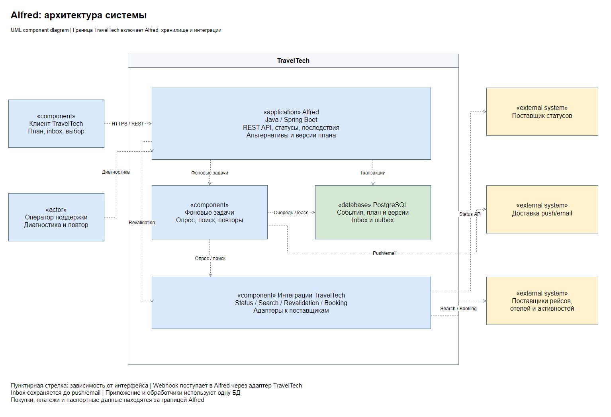
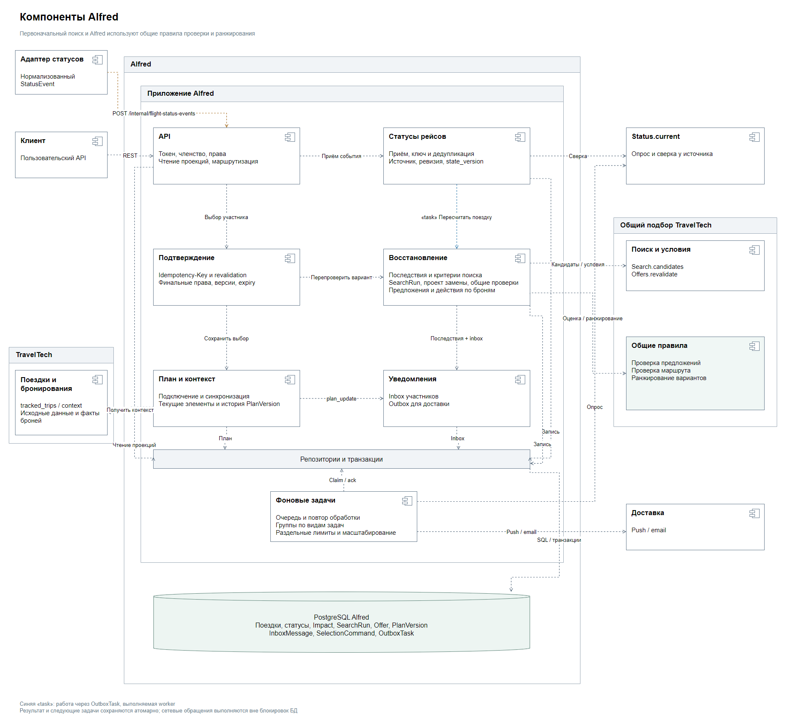
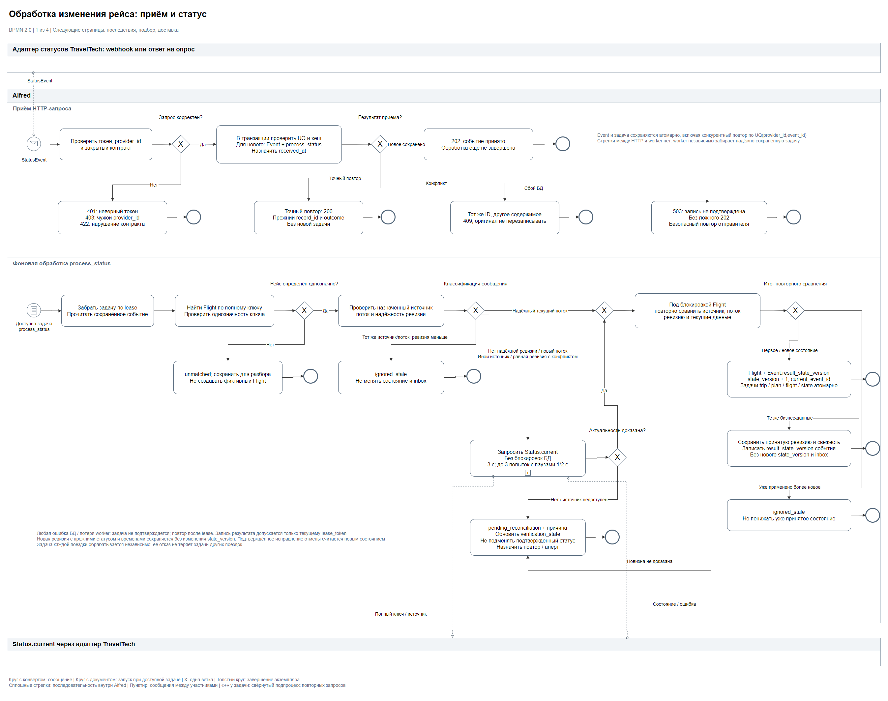
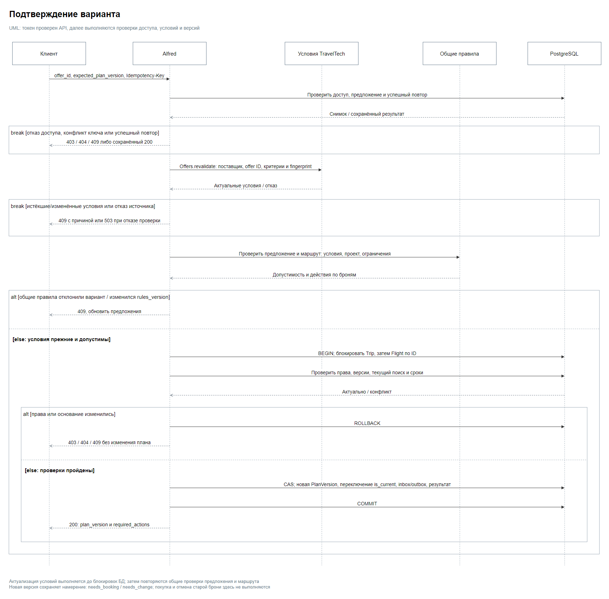

# Архитектура

## Границы и ответственность

[Исходник draw.io](diagrams/01-architecture.drawio)

Alfred является подсистемой TravelTech со своим приложением и PostgreSQL. Он реагирует на изменения рейсов, рассчитывает последствия и сохраняет выбранный общий план

TravelTech предоставляет идентификацию, исходную поездку, бронирования и общий подбор предложений. Пользователь работает в одном клиенте TravelTech: первоначальный поиск и восстановление поездки используют разные сценарии одного продукта

| Ответственность | Владелец |
|---|---|
| Обращения к поставщикам, нормализация кандидатов, актуальные условия | Общий модуль подбора TravelTech и его адаптеры |
| Багаж, вместимость, разрешения, срок предложения | Общие правила проверки предложений TravelTech |
| UTC, пересадки, достижимость временных окон | Общие правила проверки маршрута TravelTech |
| Детерминированная сортировка по выбранной политике | Общие правила ранжирования TravelTech |
| Причина нарушения, состав изменения плана, действия с бронями | Alfred |
| Права подтверждения, версии, идемпотентность, inbox/outbox | Alfred |
| Фактические покупки, платежи, изменение броней, паспорта | Booking-контур TravelTech |

Обычный поиск вызывает общие правила с пользовательскими критериями. Alfred формирует критерии восстановления и проект изменения плана, затем вызывает те же правила. Механизм проверки и сортировки один; политики порядка различаются по назначению

Адаптеры переводят контракты поставщиков. Общие правила проверки и ранжирования отделены от интеграций; способ их реализации не фиксируется

## Компоненты Alfred

[Исходник draw.io](diagrams/05-alfred-components.drawio)

| Компонент | Ответственность |
|---|---|
| API | Проверенный пользовательский/служебный токен, доступ, маршрутизация команд, чтение проекций |
| Статусы рейсов | Приём и дедупликация событий, полный ключ, источник/поток, сверка, Flight.state_version |
| Восстановление | Оценка текущего плана, Impact, критерии поиска, проект замены, общие проверки и ранжирование, сохранение Offer |
| Подтверждение | Сохранённый результат команды, повторная проверка выбранного варианта, права и версии перед commit |
| План и контекст | Подключение, синхронизация, текущая проекция, неизменяемые PlanVersion |
| Уведомления | Inbox и задачи доставки в транзакции вызывающего компонента |
| Фоновые задачи | Очередь OutboxTask, отдельные группы обработчиков по видам задач |
| Репозитории и транзакции | Единый доступ к PostgreSQL; сценарий задаёт границу транзакции, участвующие компоненты используют одно соединение |

Каждый запуск представлен SearchRun; Impact.current_search_id указывает на его ID. SearchRun и одна возобновляемая задача создаются одной транзакцией; неполные критерии не отправляются поставщику. Повтор страницы продолжает тот же запуск, истечение вариантов или смена критериев создают новый под блокировкой Trip. Поздний ответ старого search_id не публикуется

Результаты поиска хранятся с evaluated_plan_version, версиями исходных рейсов, rules_version, политикой/признаками ранжирования и fingerprint условий. Общие правила принимают типизированные снимки данных и не загружают поездку из БД Alfred самостоятельно

## Подключение и контекст поездки

Worker раз в минуту читает Booking.tracked_trips(cursor), затем Booking.context. Начальная загрузка возвращает активные поездки, изменения включают отключение tracking_enabled. Одна контрольная OutboxTask с ключом sync:booking:tracked_trips хранит cursor. Задачи контекста, следующий cursor и возврат контрольной задачи в ready фиксируются одной транзакцией. При has_more=true чтение продолжается, иначе next_attempt_at назначается через минуту. Пока интеграция включена, контрольная задача не завершается и не попадает под очистку

При первом подключении создаются Trip, активные участники, элементы, версия 1, задачи проверки рейсов и пересчёта. Источник контекста передаёт монотонную source_revision; старая игнорируется, одинаковая с другим хешем требует сверки

После подключения Alfred владеет выбранным планом. Текущая проекция содержит PlanItem с is_current=true; замена создаёт новые ID, архивные элементы сохраняются для истории и внешних ключей. Booking остаётся источником участников, ограничений и фактов броней. Снимок Booking обновляет факты, связанные с текущими элементами. Первое подтверждение новой услуги связывается по (trip_id, plan_item_id), после чего Alfred сохраняет booking_ref. Для уже связанных услуг применяется booking_ref. Подтверждение для архивного элемента не возвращает его в маршрут

Изменения участников, прав, ограничений и статуса брони создают новую PlanVersion и пересчёт; прежние предложения устаревают. Удалённый участник помечается active=false, ссылки истории сохраняются. Снятие tracking_enabled останавливает задачи этой поездки; общий рейс продолжают отслеживать для других активных поездок

## Статусы и последствия

Процесс разделён на четыре страницы в [draw.io](diagrams/02-status-process.drawio). Фоновая задача запускается независимо после сохранения в OutboxTask, когда наступил next_attempt_at

| Страница | Содержание |
|---|---|
| [Приём и статус](diagrams/02-status-process.png) | Проверка запроса, повторы, сверка и защита от устаревшего состояния |
| [Последствия](diagrams/02-status-process-impacts.png) | Пересчёт каждой поездки, нарушение, неопределённость, уведомления |
| [Подбор альтернатив](diagrams/02-status-process-search.png) | Страницы поиска, ограничения, актуальность и четыре исхода выдачи |
| [Доставка](diagrams/02-status-process-delivery.png) | Проверка участника, push/email, повторы и отказ поставщика |

Для всех фоновых этапов ошибка БД или потеря обработчика оставляет задачу для безопасного повтора. Текущий lease_token проверяется при записи результата и завершении; worker с утраченным lease не продвигает cursor и не публикует результат

1. Адаптер принимает webhook или получает ответ на опрос и формирует единый StatusEvent. Alfred проверяет служебный токен, provider_id и закрытый список полей
2. UQ(provider_id,event_id) и хеш защищают приём. Точный повтор возвращает прежний record_id/текущий outcome, другое содержимое под тем же ID даёт 409 без изменения оригинала
3. received_at назначает Alfred. Событие и process_status сохраняются одной транзакцией до ответа 202; при отказе БД возвращается 503
4. Полный ключ сопоставляется с Flight. Неизвестный ключ остаётся unmatched для разбора; фиктивная поездка или рейс не создаётся
5. Надёжные ревизии сравниваются только внутри одного рейса, назначенного источника и потока. Меньшая устарела, равная с другими данными конфликтует. Отсутствие надёжной ревизии, смена источника/потока требуют Status.current
6. Сверка выполняется без блокировок БД. Перед записью под блокировкой Flight повторяется сравнение с текущими данными. Если новизна не доказана или источник недоступен, остаётся pending_reconciliation
7. Первое подтверждение или изменение статуса/ожидаемых времён увеличивает state_version; current_event_id и задачи поездок сохраняются атомарно. Подтверждённая более новая ревизия и свежесть сохраняются и при прежних статусе и временах. В этом случае state_version и current_event_id сохраняются, новые задачи и сообщения не создаются
8. process_impact содержит plan_version и использует ключ impact:trip_id:plan_version:flight_id:state_version. Он блокирует Trip, затем Flight по ID и использует текущие элементы плана. Изменение плана создаёт новую задачу даже при прежнем состоянии рейса. Устаревшая задача не применяется; задача нового состояния уже сохранена. Проверка маршрута по общим правилам даёт последствия, которые фиксируются вместе с inbox и задачами поиска/доставки

Один Flight может входить в несколько поездок: ограничения, последствия и адресаты у каждой свои. Новая поездка и новая версия плана пересчитываются по известному состоянию без ожидания нового события. При state_version=0 сначала запрашивается подтверждение

Без нарушения сохраняется status_update без поиска. При нарушении сообщение объединяет статус и последствия. Если критериев подбора недостаточно, сохраняются needs_information и temporarily_unavailable с причиной; обновление контекста инициирует новый запуск. Отмена не требует выдуманного фактического прибытия; неизвестные MCT/времена дают needs_information. Подтверждённое исправление отмены пересчитывает результат: исчезнувшее нарушение становится resolved, потерявшее связь с текущим планом superseded. Связанные поиски останавливаются, их результаты не публикуются

## Общий подбор и восстановление

1. Alfred читает текущий план и ограничения из своей БД, фиксирует их версии и формирует SearchCriteria: вид предложения, направление/место, UTC-окно, группа, требования и валюта
2. Search.candidates получает страницы от поставщиков. Общий модуль нормализует условия и сохраняет различие тарифов; разные предложения одного рейса не сливаются только по номеру рейса
3. Общие правила проверяют полный кандидат: статус участков, вместимость всей группы, багаж с подтверждёнными допопциями, право каждого участника на маршрут/даты, валюту и expiry. Неизвестные обязательные сведения не считаются разрешением
4. Alfred строит проект изменения плана. Общие правила маршрута проверяют стыковку с сохраняемыми участками, MCT/запасы, переезды, географию и окна отеля/трансфера/активностей. Этот же расчёт используется для первоначального выявления последствий
5. Alfred определяет изменяемые элементы и required_actions. Общее ранжирование сортирует только допустимые транспортные/активностные варианты по RECOVERY_FLIGHT или RECOVERY_ACTIVITY. Обычный поиск использует ту же реализацию с DISCOVERY
6. Перед публикацией повторно проверяются current_version, состояния исходных рейсов, правила, current_search_id и lease_token. Устаревший ответ отбрасывается. Offer, SearchRun с cursor/полнотой/причинами и переход задачи в ready либо done сохраняются одной транзакцией. Следующая страница продолжает ту же задачу, новый запуск создаёт новый SearchRun

RECOVERY_FLIGHT: время до прибытия от общего earliest_start_at (включая ожидание), число добавленных/заменённых/удалённых элементов, полная цена для группы, offer_id по возрастанию. earliest_start_at фиксирован для всего запуска, один изменяемый элемент считается один раз. RECOVERY_ACTIVITY: сумма совпадений тегов с интересами каждого активного участника по убыванию, затем цена и ID. Жёсткие проверки выполняются до этих правил; цена не компенсирует запрет маршрута или недостаточную пересадку

Пагинация и отказы не скрываются. Если подходящих вариантов пока нет и остаются страницы, возвращается searching. available может содержать проверенные варианты при search_complete=false; интерфейс сообщает, что поиск неполон. none_eligible допустим только для завершённого поиска выбранных источников, отказ без результатов даёт temporarily_unavailable. Глобально лучший вариант на всём рынке не обещается

При чтении альтернатив API в одном снимке БД проверяет, что последствие относится к текущему элементу и не закрыто, а текущий SearchRun соответствует версии плана, состояниям исходных рейсов и действующей версии правил. Пока актуальный результат готовится, API возвращает searching с пустым списком и search_complete=false. Последствие resolved/superseded или архивный элемент дают 404. В выдаче остаются только варианты с expires_at позже момента чтения

Новый статус рейса или контекст ставят задачу пересчёта. Фоновая проверка открытых поисков порциями подхватывает смену версии правил и истечение всей ранее доступной выдачи. Перед запуском под блокировкой Trip проверяются основание и текущий search_id, чтобы параллельные обработчики не создавали второй поиск. Если старое последствие ждёт пересчёта по новой версии плана или рейса, новый поиск создаёт обработчик актуального последствия

Перелёт может требовать изменения старого трансфера или брони. Такие элементы помечаются needs_change, действия показаны до подтверждения; весь маршрут не объявляется восстановленным. Неизвестность по багажу, праву на маршрут или безопасности самой пересадки этим механизмом не обходится

Активность может заполнить ожидание или заменить другую активность, но не закрывает отменённый перелёт. Полный подбор нового отеля и фактическое изменение броней остаются в обычном TravelTech

## Подтверждение и версия плана

1. API проверяет активное членство, право организатора/делегирование и прежний успешный результат Idempotency-Key в пределах trip+actor+operation. Повтор с другим телом даёт 409
2. Восстановление вызывает Offers.revalidate за текущими условиями и повторяет общие проверки предложения и маршрута на актуальном контексте. Проверяются срок результата проверки маршрута и применимость разрешения на даты поездки, выбранные допопции и полная цена. При отказе источника план не меняется
3. Изменение цены/условий требует нового выбора. Изменение rules_version, версии плана, состояния рейса или последствия делает старое предложение непригодным для подтверждения
4. В короткой транзакции блокируются Trip и связанные Flight по ID; снова проверяются active, owner_id/can_confirm, current_version, состояния рейсов, rules_version, открытое последствие, current_search_id и сроки предложения и подтверждённых проверок. Сетевых вызовов под блокировкой нет
5. CAS current_version=expected_plan_version допускает один конкурентный выбор. PlanVersion, переключение is_current элементов, inbox, outbox, пересчёт/проверки новых рейсов и результат SelectionCommand сохраняются одной транзакцией

Выбор AX 204 создаёт needs_booking, а не выпущенный билет; старая бронь автоматически не отменяется. Реальное оформление запускается в TravelTech с ID выбранного элемента. Подтверждение применяется по правилам синхронизации контекста. Успешный повтор команды возвращает прежний результат даже после expiry предложения, но только после повторной проверки доступа

## Надёжность и доступ

OutboxTask хранит dedup_key, основание/версии, attempts, next_attempt_at и lease. Claim через FOR UPDATE SKIP LOCKED фиксируется короткой транзакцией, завершение допускает только текущий lease_token. Истёкший lease позволяет повтор; бизнес-идемпотентность защищает результат после потери ack. Ключ опроса рейса или проверки контекста включает цикл запуска; контрольная задача списка поездок сохраняет постоянный ключ и cursor. Для поиска ключ search:search_id принадлежит одной возобновляемой задаче; SearchRun хранит выдачу независимо от очистки очереди

| Ситуация | Решение |
|---|---|
| Потеря webhook | Опрос активных рейсов ближайших 24 ч раз в 5 мин через тот же приём статусов |
| Status/Search/Revalidation недоступны | Тайм-аут 3 с, всего 3 попытки с паузами 1 и 2 с; затем pending/unavailable без выдуманных данных |
| Commit выполнен, ответ потерян | Возврат сохранённого результата или безопасное повторное выполнение задачи |
| Push/email недоступны, пользователь оффлайн | Inbox уже сохранён; повторы доставки через 1, 5 и 30 мин, затем оператор |
| Контекст устарел | Видна свежесть, подтверждение без актуальных обязательных условий отклоняется |
| Все предложения истекли | Они убираются из доступных, создаётся новая задача поиска |

Интервалы являются проектными параметрами, согласуемыми с поставщиками. После недавней отмены опрос продолжается до подтверждённой замены/завершения поездки. Остановка отслеживания учитывается при выполнении уже взятой задачи

План читается в одной read-only транзакции REPEATABLE READ. Inbox упорядочен по sequence_no, назначенному под блокировкой Trip и сохранённому с сообщением; курсор trip/user/sequence_no не теряет поздний commit. Push/email получают стабильный ключ, но без дедупликации поставщика повтор внешнего сообщения возможен

Alfred проверяет подпись, issuer, audience и срок токена, затем active и членство. Подтверждение разрешено при active=true и (user_id=owner_id или can_confirm=true). Чужой объект даёт 404, отсутствие права подтверждения своему участнику 403. Статусы принимаются отдельной служебной audience с привязкой provider_id

Оператор видит технические ID, ошибки и очередь, повторяет исходный обработчик без редактирования payload или маршрута. Перед отправкой уведомления повторно проверяется активное членство. Паспорта, токены и тела ошибочных запросов не логируются; общие объяснения не раскрывают документы участника

Алерт срабатывает, если готовая задача ждёт больше 60 с или три проверки поставщика подряд завершились ошибкой. Свежесть контекста, сверку и задержку источника отслеживаем отдельно

## Нагрузка и масштабирование

API и фоновые обработчики Alfred запускаются отдельными процессами одного приложения. API читает состояние из PostgreSQL и отвечает 202 после фиксации события и задачи. Фоновые процессы можно добавлять отдельно от API

Обработчики выбирают из OutboxTask только назначенные им виды задач. Статусы, пересчёт поездок с записью Inbox, поиск, доставка и служебная синхронизация с опросом работают в отдельных группах. У каждой группы свой лимит параллельных задач

Число соединений с PostgreSQL ограничено суммарно по всем экземплярам, с резервом для API, статусов и пересчёта. Квота поставщика делится между всеми вызывающими его экземплярами. В группе статусов число параллельных сверок ограничено, чтобы оставались слоты для событий с надёжной ревизией. Если свободной квоты или слота для сверки нет, задача получает новый next_attempt_at без расходования попытки. Ожидание поставщика не удерживает транзакцию

На пике задержка поиска или push/email не блокирует запись Inbox. Незавершённый подбор отображается как searching, при исчерпании повторов без результата действует temporarily_unavailable. Предложения с истёкшим сроком исключаются, а при выборе проверяются актуальные условия

Профиль N-05 задаёт обычную нагрузку и минутный пик. Одна отмена на пике затрагивает 100 поездок по три участника: один статус создаёт 100 задач пересчёта и 300 сообщений Inbox. Время измеряется до записи последнего сообщения по событию, доставка push/email в метрику не входит

По каждому виду задач измеряем число и возраст готовых задач, время ожидания и выполнения. Если очередь растёт при занятых обработчиках и запасе ресурсов БД, добавляем процессы этой группы. Если растут ожидание соединений, блокировки или время транзакции обновления рейса, сначала проверяем запросы, индексы и объём записи задач на один рейс. Увеличение числа процессов ограничено ёмкостью PostgreSQL и квотами поставщиков

## Покрытие требований кейса

| Условие кейса | Решение | Требования и сценарии |
|---|---|---|
| Отслеживание рейса | Webhook + опрос, полный ключ и ревизии одного источника/потока | F-01-03; A-01-04, A-19, A-25-26, A-28-29 |
| Задержка/отмена и последствия | Общие проверки актуального плана, отдельный расчёт каждой поездки | F-04; A-05-07, A-22, A-33-36 |
| Уведомление и оффлайн | Inbox и outbox атомарно с результатом, cursor по sequence_no | F-05, N-01; A-08, A-18, A-31-32, A-37 |
| Альтернативные перелёты/активности | Общие правила и сортировка, проект восстановления в Alfred | F-06-07; A-09-10, A-24, A-30, A-38-41, A-44, A-46, A-49, A-51 |
| Обновление общего плана | Revalidation, права, версии, CAS, история и действия по броням | F-08-09; A-11-14, A-20, A-23, A-27, A-42-43, A-48 |
| Группы и защита данных | Активное членство, делегирование, отдельные service audience | F-10, N-03-04; A-15, A-17, A-23, A-29 |
| Поздние данные и отказы | Сверка, повтор версий перед записью, freshness, очередь | F-11; A-03-04, A-12, A-18-19, A-22, A-24-25, A-28, A-31-32, A-47, A-51 |
| Отели и трансферы | Достижимость и booking_action_required без ложной отмены брони | F-12; A-10, A-20, A-27, A-42 |
| Багаж, разрешения и часовые зоны | Общие проверки предложения и маршрута, допопции в цене, UTC/IANA | N-02; A-09, A-16, A-33, A-40, A-44-45 |
| Скорость обработки | Цели для обычной нагрузки, пика и массовой отмены | N-05; A-21, A-50 |

