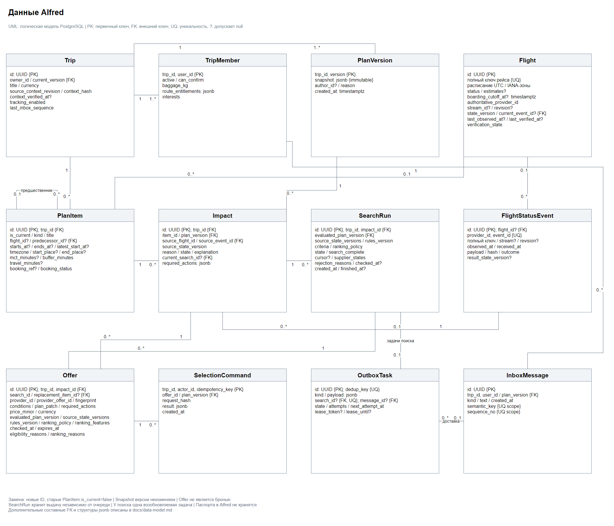

# Модель данных



[Исходник draw.io](diagrams/04-data-model.drawio)

Логическая модель PostgreSQL. PK обозначает первичный ключ, FK внешний ключ, UQ уникальность, `?` допускает null. ID имеют тип UUID, версии и счётчики bigint, флаги boolean, моменты timestamptz, структурированные значения jsonb. Суммы хранятся целыми минимальными единицами валюты ISO 4217

## Сущности

| Сущность | Основные данные |
|---|---|
| Trip | `id` PK, `title`, `owner_id`, `current_version`, `currency`, `source_context_revision`, `context_hash`, `context_verified_at?`, `tracking_enabled`, `last_inbox_sequence` |
| TripMember | PK `(trip_id, user_id)`, `active`, `can_confirm`, `baggage_kg`, `route_entitlements`, `interests` |
| PlanVersion | PK `(trip_id, version)`, неизменяемый `snapshot`, `author_id?`, `reason`, `created_at` |
| PlanItem | `id` PK, `trip_id` FK, `is_current`, `kind`, `title`, `flight_id?` FK, `predecessor_id?` FK, `starts_at?`, `ends_at?`, `latest_start_at?`, `timezone`, `start_place?`, `end_place?`, `mct_minutes?`, `buffer_minutes`, `travel_minutes?`, `booking_ref?`, `booking_status` |
| Flight | `id` PK, полный ключ UQ, исходное UTC-расписание и IANA-зоны, `status`, ожидаемые времена?, `boarding_cutoff_at?`, `authoritative_provider_id`, `stream_id?`, `revision?`, `state_version`, `current_event_id?` FK, `last_observed_at?`, `last_verified_at?`, `verification_state` |
| FlightStatusEvent | `id` PK, `provider_id`, `event_id`, ключ рейса, `flight_id?` FK, поток/ревизия?, `observed_at`, серверное `received_at`, разрешённый `payload`, хеш, `outcome`, `result_state_version?` |
| Impact | `id` PK, `trip_id`, `item_id`, `source_flight_id`, `source_event_id`, `source_state_version`, `plan_version`, `reason`, `state`, `current_search_id?`, `required_actions`, `explanation` |
| SearchRun | `id` PK, `trip_id`, `impact_id`, `evaluated_plan_version`, `source_state_versions`, `rules_version`, `criteria`, `ranking_policy`, `state`, `search_complete`, `cursor?`, `supplier_states`, `rejection_reasons`, `checked_at?`, `created_at`, `finished_at?` |
| Offer | `id` PK, `trip_id`, `impact_id`, `search_id`, `kind`, `replacement_item_id?`, `provider_id`, `provider_offer_id`, `fingerprint`, `conditions`, `plan_patch`, `eligibility_reasons`, `price_minor`, `currency`, `checked_at`, `expires_at`, `evaluated_plan_version`, `source_state_versions`, `rules_version`, `ranking_policy`, `ranking_features`, `ranking_reasons`, `required_actions` |
| InboxMessage | `id` PK, `trip_id`, `user_id`, `kind`, `text`, `semantic_key`, `sequence_no`, `plan_version`, `created_at` |
| OutboxTask | `id` PK, `kind`, `dedup_key`, `search_id?` FK/UQ, `message_id?` FK, типизированный `payload`, `next_attempt_at`, `attempts`, `lease_token?`, `lease_until?`, `state` |
| SelectionCommand | PK `(trip_id, actor_id, idempotency_key)`, `request_hash`, `offer_id` FK, сохранённый `result`, `plan_version`, `created_at` |

Пользователи и аутентификация находятся в TravelTech. В Alfred хранится членство в поездках, отдельная таблица аккаунтов не нужна. Участники следуют одному общему плану

## Текущий план и история

GET поездки возвращает только PlanItem с `is_current=true` и активных участников в одном согласованном снимке БД

Замена создаёт новые ID элементов. Прежние получают `is_current=false` и сохраняются для ссылок Impact, Offer и истории; физическое удаление при изменении маршрута запрещено. Сохраняемые элементы сохраняют ID. Предшественник текущего элемента тоже должен быть текущим элементом этой поездки. У текущей цепочки не более одного корня и одного последователя на элемент; циклы запрещены

Переключение элементов, изменение участников/ограничений, новая PlanVersion, Trip.current_version, inbox и outbox сохраняются одной транзакцией. Snapshot содержит состав плана с ID, исходным расписанием, участниками, правами и ограничениями на момент версии. Оперативный статус Flight обновляется отдельно и не переписывает историю плана. Системное изменение имеет author_id=null и явную причину

`booking_ref` идентифицирует конкретную услугу или сегмент брони. Новый PlanItem в needs_booking создаётся с booking_ref=null. При первом подтверждении Booking.context передаёт (trip_id, plan_item_id), booking_ref и параметры услуги. Alfred привязывает ссылку к текущему элементу при совпадении услуги. Повтор факта не создаёт PlanVersion, а подтверждение для архивного элемента не меняет текущий маршрут

## Структурированные данные

| Значение | Содержание и проверка |
|---|---|
| start_place, end_place | Вид airport/place, код IATA или ID места TravelTech, страна ISO 3166-1 alpha-2, IANA-зона, терминал при необходимости. У отеля/активности это одно место, у перелёта/трансфера разные точки |
| route_entitlements | Для маршрута/транзитных пунктов и диапазона дат: allowed/denied/unknown, непрозрачный check_ref, checked_at, valid_until. Паспортных реквизитов и изображений нет |
| conditions | Поставщик и тариф, участки/место/UTC-окно, места группе, подтверждённый багаж и платные опции, полная цена/валюта, временные правила и сроки. Offer.expires_at равен ближайшему из срока поставщика и сроков обязательных подтверждений допустимости, в том числе valid_until разрешения на маршрут. Для перелёта условия относятся ко всем участкам и участникам; API baggage_by_member содержит каждого активного участника, сводный baggage_kg равен минимуму норм |
| plan_patch | base_plan_version, remove_item_ids, add_items, update_items. Новые элементы имеют заранее назначенные UUID; вставка только при подтверждении. Ссылки относятся к этой поездке, итог проверяется на циклы и достижимость |
| required_actions | Коды действий с ID элемента и объяснением: оформить услугу, изменить или уточнить бронь. В API Offer возвращаются объяснения для пользователя |
| criteria, cursor, supplier_states, rejection_reasons | Критерии и фиксированный earliest_start_at запуска; курсоры поставщиков и признак завершения/ошибки каждого. Неуспешный источник не помечается завершённым; причины исключения сохраняются как набор кодов без персональных данных |

Неизвестное место хранится как null. Неизвестное место, MCT, терминал или время переезда не заменяются значением 0. Переезд должен быть подтверждён TravelTech для соответствующих точек; иначе needs_information. Для первого участка без пересадки mct_minutes=null означает «не применяется»

`Impact.reason=waiting_activity` обозначает возможность во время задержки. item_id указывает на задержанный перелёт, required_actions пуст, state=open. SearchRun хранит границу посадки и зону ожидания в criteria, а Offer добавляет активность с replacement_item_id=null. Срок Offer также ограничен свежестью окна и последним моментом, когда группа ещё успеет к началу активности

## Поиск и фоновые задачи

SearchRun хранит состояние выдачи, OutboxTask работу обработчика. Impact.current_search_id указывает на текущий SearchRun, Offer.search_id на запуск, подготовивший вариант. Пустая таблица Offer сама по себе не означает none_eligible

На запуск создаётся одна возобновляемая задача kind=search с search_id и ключом `search:<search_id>`. После страницы одной транзакцией сохраняются Offer, SearchRun.cursor/полнота/состояние и эта же задача: ready с next_attempt_at для продолжения либо done после завершения. Отдельная задача с тем же ключом для каждой страницы не создаётся

Сетевой вызов выполняется вне транзакции. Перед публикацией проверяются версии плана, исходных рейсов и правил, current_search_id и lease_token. Потерявший lease worker не пишет результат. Поздняя страница старого запуска не заменяет новый поиск даже при прежних версиях плана и рейсов

Повторная страница не дублирует Offer: UQ `(search_id, provider_id, provider_offer_id, fingerprint)`. Одинаковые нормализованные условия тарифа имеют одинаковый fingerprint; разные тарифы одного рейса не сливаются. Версии основания и политика Offer совпадают с SearchRun

SearchRun создаётся вместе с задачей при запуске подбора. Criteria хранит снимок, включая неизвестные значения; к поставщикам передаётся только полный запрос. При нехватке критериев сохраняются needs_information в Impact и temporarily_unavailable в SearchRun; задача завершается до обновления контекста. Новые критерии создают новый запуск

Выдача проверяет актуальность SearchRun и срок каждого Offer в одном снимке БД. Истечение всей ранее доступной выдачи подхватывает фоновая проверка и создаёт новый SearchRun. Очистка завершённых OutboxTask после окна повторов не удаляет SearchRun, Offer или состояние выдачи. SearchRun хранится, пока на него ссылаются Impact/Offer; связанные данные удаляются в порядке FK. `finished_at` фиксирует завершение полного поиска либо его остановку при замене запуска/разрешении последствия

## Ключи задач и защита от повторов

| Вид работы | dedup_key |
|---|---|
| Обработка события | `status:<event_id>` с внутренним UUID события |
| Последствия для поездки | `impact:<trip_id>:<plan_version>:<flight_id>:<state_version>` |
| Поиск / следующая страница | `search:<search_id>`; одна задача переходит processing → ready или done |
| Доставка | `delivery:<message_id>:<channel>` |
| Список поездок TravelTech | `sync:booking:tracked_trips`; одна контрольная задача с cursor |
| Опрос рейса / контекст поездки | Вид задачи, объект и устойчивый ID цикла запуска |

Контрольная задача sync:booking:tracked_trips хранит служебный cursor в payload и остаётся ready/processing, пока интеграция включена. Каждая страница атомарно сохраняет дочерние задачи контекста, следующий cursor и next_attempt_at. После последней страницы задача ждёт минуту, а не становится done; очистка завершённых задач её не затрагивает

Задача process_impact содержит plan_version, source_event_id? и source_state_version. Новая версия плана создаёт новый ключ без изменения рейса. При state_version=0 события ещё нет: сначала назначается проверка источника. Устаревшая задача гарантирует наличие актуального пересчёта и не применяет прежний результат

Обработчик выбирает задачи своего вида с наступившим next_attempt_at либо истёкшим lease_until. Claim выполняется ограниченными партиями короткой транзакцией через FOR UPDATE SKIP LOCKED. Завершение, повтор и публикация допускаются только с текущим lease_token. Потеря worker или ack допускает повтор без нового бизнес-эффекта. Конкурентный повтор выбора разрешается уникальным ключом и сохранённым результатом

## Связи и ограничения

ID сущностей уникальны глобально. Для составных FK дополнительно задаются UQ на указанные сочетания столбцов; частичные индексы текущих элементов не используются как цель FK

| Связь | Ограничение |
|---|---|
| Trip → TripMember | `(id, owner_id)` ссылается на `(trip_id, user_id)`; организатор должен быть активен |
| Trip → PlanVersion | `(id, current_version)` ссылается на `(trip_id, version)` |
| PlanItem → PlanItem | `(trip_id, predecessor_id)` ссылается на `(trip_id, id)` |
| Impact → PlanItem / PlanVersion | Элемент и `(trip_id, plan_version)` принадлежат той же поездке |
| Impact → Flight / Event | Событие относится к source_flight_id; result_state_version совпадает с source_state_version последствия |
| SearchRun → Impact / PlanVersion | `(trip_id, impact_id)` и `(trip_id, evaluated_plan_version)` относятся к одной поездке |
| Impact → текущий SearchRun | `(trip_id, id, current_search_id)` ссылается на `(trip_id, impact_id, id)` SearchRun; до старта current_search_id=null |
| Offer → SearchRun / PlanItem | `(trip_id, impact_id, search_id)` ссылается на тот же запуск; replacement_item_id относится к этой поездке либо null при добавлении |
| InboxMessage / SelectionCommand → TripMember | `(trip_id, user_id/actor_id)` ссылается на участника поездки; снятие доступа означает active=false, а не удаление строки |
| SelectionCommand → Offer / PlanVersion | Выбранный offer и созданная версия относятся к этой поездке |
| OutboxTask → SearchRun / InboxMessage | Для search обязателен search_id, для delivery message_id; для остальных видов оба null |
| Flight → текущий Event | current_event_id относится к этому же Flight; state_version=0 соответствует current_event_id=null |

Циклические FK Trip/TripMember/PlanVersion и Flight/Event проверяются в конце транзакции. Impact создаётся с пустым current_search_id, затем SearchRun и указатель связываются одной транзакцией. Проверки активности, цепочки и соответствия версий выполняются приложением под блокировками; FK не заменяют проверку доступа

Другие UQ: `(provider_id, event_id)` события; `(trip_id, item_id, source_event_id, source_state_version, plan_version, reason)` последствия; `(trip_id, user_id, semantic_key)` сообщения; `(trip_id, sequence_no)` inbox; OutboxTask.dedup_key

Semantic_key уведомлений: `status:flight:state_version`, `disruption:flight:state_version:plan_version`, `plan:version`. Сообщение о нарушении объединяет последствия расчёта. Sequence_no назначается под блокировкой Trip и сохраняется с сообщением, чтобы cursor не пропускал поздний commit

Kind=flight требует flight_id, остальные виды требуют null. Багаж, MCT, запасы, переезды и суммы неотрицательны. Конец интервала не раньше начала; checked_at не позже expires_at. Истёкшее разрешение или неприменимость к датам поездки исключают подтверждённую допустимость

## Идентификация рейса

Flight.id является внутренним UUID, поставщик его не знает. Сообщение сопоставляется по полному UQ:

```text
operating_carrier + flight_number + departure_date
+ origin + destination + scheduled_departure_local
```

Используются выполняющий перевозчик, нормализованный номер, местная дата и исходное время HH:mm, IATA-коды аэропортов. 24:00 нормализуется в 00:00 следующей даты. Ожидаемая задержка не меняет ключ. Codeshare приводит к выполняющему перевозчику адаптер по подтверждённому справочнику; неоднозначное событие остаётся unmatched

Моменты сравниваются в UTC, исходные локальные дата/время и IANA-зоны сохраняются отдельно. При неоднозначном местном времени требуется offset или уточнение у источника

## Состояния и представление API

| Объект | Состояния |
|---|---|
| Flight | scheduled, delayed, cancelled, departed, arrived |
| Проверка Flight | confirmed, pending_reconciliation, unavailable |
| Event | received, unmatched, pending_reconciliation, applied, ignored_stale, conflict |
| Impact | open, needs_information, resolved, superseded |
| SearchRun | searching, available, none_eligible, temporarily_unavailable |
| Бронирование элемента | booked, needs_booking, needs_change, not_required |
| OutboxTask | ready, processing, done, failed |

`verification_state` хранится в Flight. Неудачная сверка меняет её и сохраняет причину в событии/задаче, но не подменяет подтверждённый статус. Flight.revision хранит последнюю принятую надёжную ревизию назначенного источника и потока, включая сообщения с прежними статусом, временами и boarding_cutoff_at. При сверке без надёжной ревизии тот же поток сохраняет известную границу. Новый поток получает свою границу только после подтверждения. state_version и current_event_id меняются при первом подтверждении состояния или изменении бизнес-данных, включая появление, сдвиг или потерю подтверждённого boarding_cutoff_at. Поле result_state_version события фиксирует применённую версию

`context_state` вычисляется по проверке контекста и синхронизации. Impact.booking_action_required вычисляется по действиям уточнения/изменения брони. Offer API строится из conditions и объяснений; внутренние payload, snapshot и разрешения участников целиком пользователю не передаются

Частичные UQ текущего плана: один корень на trip_id и один последователь на (trip_id, predecessor_id). При замене сначала архивируются старые элементы, затем вставляются новые; итоговая цепочка проверяется до commit

Индексы: PlanItem по trip/is_current и flight_id; Event по flight/received_at; SearchRun по impact/created_at; Offer по search_id/expires_at; InboxMessage по trip/user/sequence_no; OutboxTask для каждого вида задач по (kind, next_attempt_at, id) с условием state=ready и по (kind, lease_until, id) с условием state=processing. Snapshot PlanVersion защищён от UPDATE/DELETE правами и триггером; откат создаёт новую версию

